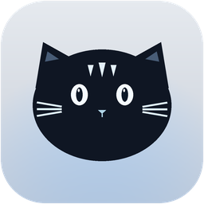
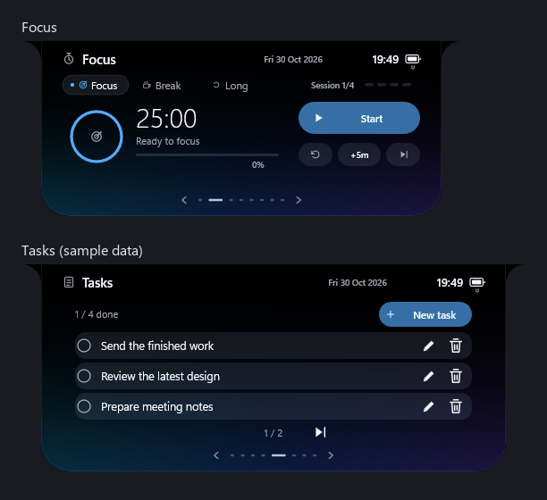
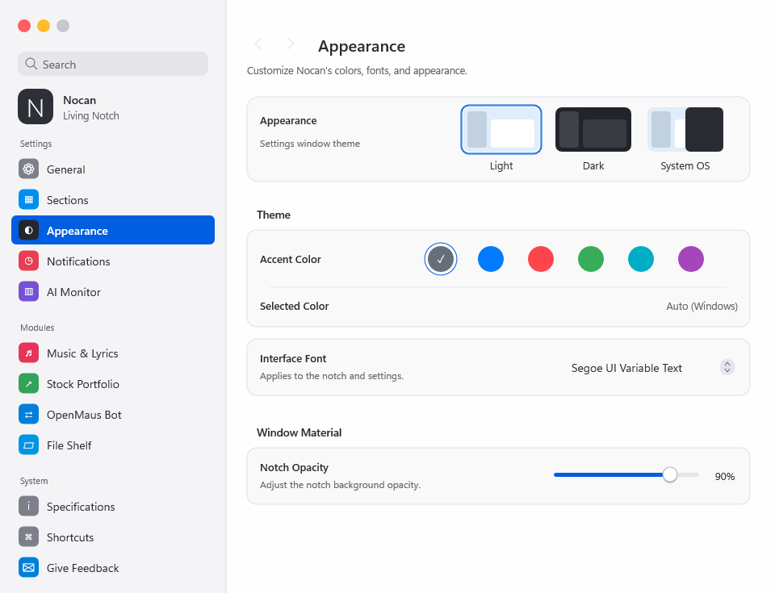
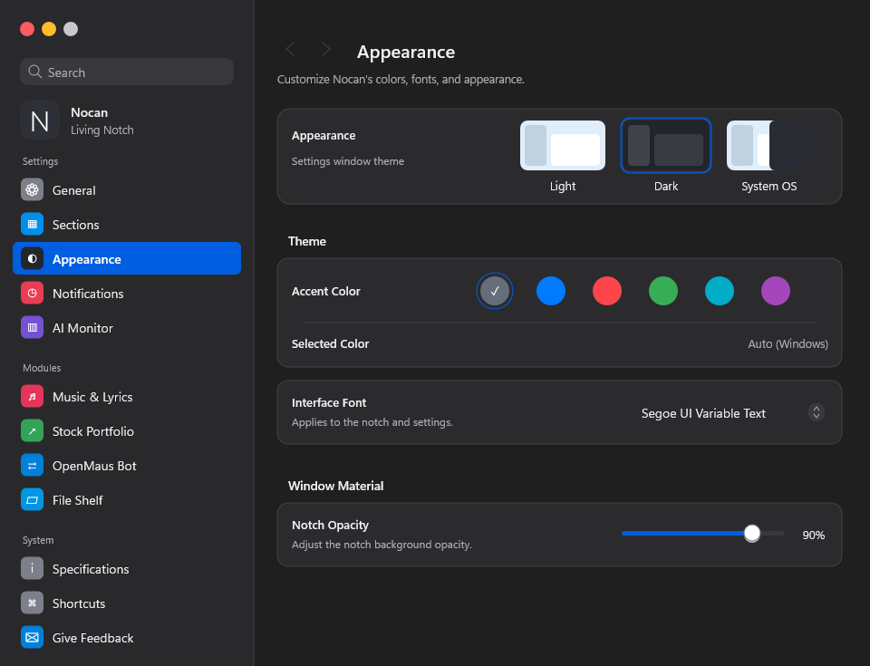

# Nocan



A native Windows desktop notch for music, focus sessions, hydration, tasks, files, and local AI activity. Nocan uses Rust, Win32, Direct2D, DirectWrite, and DirectComposition to draw an animated desktop companion with a macOS-inspired Settings window.

The interface is in English. The name combines **Notch** and **Macan**, the Indonesian word for tiger.

The [interactive website](https://fphaikal.github.io/Nocan/) includes a browser preview and a scroll-driven feature tour. Its static source lives in `docs/`; see [website documentation](docs/landing-page.md) for animation, publication, and custom-domain details.



## Contents

- [Features](#features)
- [Requirements](#requirements)
- [Build and run](#build-and-run)
- [Install, update, and uninstall](#install-update-and-uninstall)
- [Using Nocan](#using-nocan)
- [Settings](#settings)
- [Data storage and recovery](#data-storage-and-recovery)
- [Integrations and network access](#integrations-and-network-access)
- [Development](#development)
- [Project structure](#project-structure)
- [Troubleshooting](#troubleshooting)
- [Contributing](#contributing)
- [License and credits](#license-and-credits)

## Features

| Section | What it does |
| --- | --- |
| Music | Shows Windows media metadata, album artwork, playback controls, and synchronized lyrics when available. Album artwork can influence the ambient background. |
| Focus | Provides focus, short-break, and long-break sessions, pause/resume, reset, skip, and an extra-five-minute action. |
| Water | Records intake in 250 ml increments, shows daily progress and hourly totals, and displays animated reminders inside the notch. |
| Files | Copies dropped files into a local shelf for quick access. Click an item to open it with its associated application. |
| Tasks | Creates, edits, completes, and deletes tasks directly inside the notch, with pagination and an undo action for the last deletion. |
| OpenMaus | Displays local agent activity, automation schedules, completion alerts, and usage grouped by bot, model, or provider. |
| AI Usage | Reads available local usage information for Gemini/Antigravity, Claude, Codex, and OpenCode. |
| Stocks | Tracks up to six IDX or global tickers, with quotes, price changes, and recent price history when the source provides them. |

The tiger mascot follows the pointer, blinks, and reacts to clicks. The notch changes size as you move between sections. Sections can be enabled or disabled individually.

### Timer chip

The active timer appears inside the compact notch. When a song has an active lyric line, the timer detaches into a small floating chip aligned with the notch. It rejoins when the lyric line is no longer active.

The chip scales with the minimized notch and keeps its compact size when the main panel expands. Its background changes with the timer state:

| State | Color |
| --- | --- |
| More than 25% remaining | Green |
| 25% or less remaining | Amber |
| Final minute | Red |
| Paused | Gray |
| Just completed | Blue, briefly |

### Hydration reminders

Reminders use looping water motion inside the notch. Recording a drink triggers a water-fill confirmation animation. Hydration reminders do not use Windows toast notifications.

## Requirements

- Windows with a graphical desktop session; Windows 11 is the primary development environment.
- A graphics driver supporting Direct3D 11 and Direct2D.
- Rust and Cargo with support for Rust edition 2021.
- A Windows resource compiler for the selected Rust target:
  - MSVC: Visual Studio Build Tools with the C++ toolchain and Windows SDK, including `rc.exe`.
  - GNU: MinGW-w64 with `windres` and the corresponding linker.
- Internet access for the first dependency download and for lyrics, quotes, and optional artwork lookups.

Nocan is a native executable. It does not require Node.js, Electron, or a webview runtime. Linux and macOS builds are not supported.

## Build and run

Download or clone this repository, open PowerShell in its root directory, then run:

```powershell
git clone https://github.com/fphaikal/Nocan.git
cd Nocan
cargo fetch --locked
cargo build --release --locked
.\target\release\nocan.exe
```

The executable is written to `target\release\nocan.exe`. Keep it in a stable location if you enable startup with Windows.

If dependencies are already cached, build without network access:

```powershell
cargo build --release --locked --offline
```

For a debug build:

```powershell
cargo run --locked
```

If Cargo cannot find the resource compiler, use a Visual Studio developer shell or set its full path before building:

```powershell
$env:RC = 'C:\path\to\rc.exe'
# For a GNU target, set WINDRES instead of RC.
```

No separate asset-copy step is required for normal use. The application embeds its runtime icons and provider logos.

## Install, update, and uninstall

### Run without installation

Run the built executable directly. Nocan still stores its regular settings, tasks, and water history in the Windows user data directory, independently of the executable's location.

Only one normal instance runs at a time. Starting another instance opens Settings in the existing instance. To test a replacement executable, exit the previous instance from its tray menu first.

### Install from source

After fetching dependencies, run:

```powershell
.\tools\install-nocan.ps1
```

The script builds a release executable, installs it to `%LOCALAPPDATA%\Programs\Nocan`, creates Start menu and desktop shortcuts, and registers an uninstall entry for the current user. It also replaces running copies from this checkout or installation. It does not require a machine-wide installation.

For the same install-and-restart workflow during development:

```powershell
.\tools\run-debug.ps1
.\tools\run-debug.ps1 -Release
```

These helper scripts use Cargo's default `target` directory. Leave `CARGO_TARGET_DIR` unset when using them. They use offline builds, so fetch dependencies first.

### Update

Exit Nocan, replace the executable, then start the new version. If you installed from source, rerun the install script instead. The data directory does not depend on the executable name or application version.

If startup was already enabled, a normal launch refreshes the startup entry to point to the current executable. An existing disabled startup preference remains disabled.

### Uninstall

Use the Windows uninstall entry or run:

```powershell
& "$env:LOCALAPPDATA\Programs\Nocan\uninstall-nocan.ps1"
```

The script removes the installed executable, its matching shortcuts, and its matching startup entry. Settings and personal data remain available for a later reinstall.

## Using Nocan

Hover over the compact notch to expand it. Use the section navigation indicators, mouse wheel, or left/right arrow keys to move between available sections. The system tray menu opens Settings, toggles the mascot or minimal notch, controls startup, and exits the application.

### Keyboard controls

These controls apply while the relevant window or input has keyboard focus.

| Context | Key | Action |
| --- | --- | --- |
| Expanded notch | Left / Right | Previous / next section |
| Notch or Settings | Tab / Shift+Tab | Move between controls |
| Focused control | Enter / Space | Activate the control |
| Notch | Esc | Close the expanded panel or dismiss an overlay |
| Mascot | Enter / Space | Trigger a reaction |
| Task editor | Enter | Save the task |
| Task editor | Esc | Cancel the edit |
| Stock input | Enter | Add the entered tickers |
| Stock input | Ctrl+A | Select the input text |
| Floating timer | Enter / Space | Pause or resume |
| Floating timer | A | Add five minutes |
| Floating timer | R | Reset |
| Floating timer | N | Skip to the next session |

Right-click the floating timer for its session actions. Open Settings through the tray menu or launch `nocan.exe --settings`. A global keyboard shortcut is not registered in the current implementation.

## Settings



Settings include Light, Dark, and System OS themes, accent colors, installed-font selection, notch opacity, mascot visibility, minimal mode, and automatic minimization when another window is maximized.

You can also configure section visibility, hydration reminder intervals and daily targets, focus and short-break durations, provider visibility, usage polling, music ambience, dynamic lyric width, Discord presence, and the stock watchlist.

For IDX input, plain symbols such as `BBCA` receive the `.JK` suffix. Choose Global for symbols such as `AAPL`, `BRK-B`, or `^GSPC`. You can enter multiple symbols separated by commas, semicolons, or whitespace, up to the six-symbol limit.

Fonts are resolved from those installed on Windows. Selecting a font does not download it; if it is unavailable, Nocan uses an installed fallback. The repository does not distribute Apple fonts.



## Data storage and recovery

Core data is stored in the Windows Local AppData known folder under `Nocan`, normally `%LOCALAPPDATA%\Nocan`.

| File or directory | Contents |
| --- | --- |
| `settings.json` | Appearance, module visibility, productivity preferences, and the watchlist |
| `todo.json` | Task IDs, titles, and completion states |
| `water.json` | Current intake, hourly totals, daily goal, reminder state, and prior-day history |
| `*.bak` | Previous valid versions of the core JSON files |
| `Shelf\` | Copies of files added to the shelf |
| `fph_config.json` | Optional Discord configuration; the filename is retained for compatibility |
| `nocan_*.log` | Diagnostic logs created by application components |

Core settings, tasks, and water history use staged writes and backups. If a primary JSON file becomes unreadable, Nocan tries its backup. It preserves an unreadable original rather than replacing it with an empty list. Failed task or hydration saves leave the previous in-memory record intact and surface an error.

Water intake is saved when it changes. Changing the target does not erase intake. Moving to a new day archives the old totals; returning to a previously recorded date restores that day's totals.

To back up or move your data, close Nocan and copy the data directory. Keep a separate backup before editing JSON manually. Earlier builds that held water totals only in memory cannot recover totals from sessions that have already ended.

### Separate profiles

Use an absolute `NOCAN_DATA_DIR` to isolate core settings, tasks, and water history:

```powershell
$env:NOCAN_DATA_DIR = Join-Path $env:TEMP 'nocan-test-profile'
.\target\release\nocan.exe
```

This override currently applies to the core storage layer. The file shelf and Discord configuration still use `%LOCALAPPDATA%\Nocan`; AI integrations read their own applications' local directories. It is not a full isolation boundary for every integration.

Preview and render commands automatically use temporary core profiles unless `NOCAN_DATA_DIR` is explicitly set. Unit tests also use temporary profiles. See [data storage details](docs/data-storage.md).

## Integrations and network access

Nocan does not require an account or a project-hosted backend. The integrations below have their own availability and data requirements.

| Integration | Source and behavior |
| --- | --- |
| Windows media | Reads the active media session exposed by the playing application. Controls depend on what that application supports. |
| LRCLIB | Requests lyrics using track, artist, and sometimes album metadata. Synchronized lyrics are shown when available. |
| Yahoo Finance | Requests quotes and history for watchlist tickers. Data can be delayed or unavailable. |
| OpenMaus Bot | Reads local bot, event, routine, lease, and usage files. It does not start agents, execute automations, or edit schedules. |
| AI usage | Reads available local usage/session/cache files. Results depend on the installed tools and their file formats. |
| Discord Rich Presence | Uses local Discord IPC to publish the current track when configured and enabled. Album artwork lookup can send track metadata to Apple's iTunes search service; source icons use external image URLs. |

Usage totals are based on the records available on this machine. They are not an account-wide billing statement. Costs appear only when the source reports them. Nocan does not ask you to enter provider API keys for these usage panels.

### OpenMaus Bot

The default source directory is `%USERPROFILE%\.openmausbot`. Override it when needed:

```powershell
$env:NOCAN_OPENMAUS_DIR = 'D:\OpenMausData'
.\target\release\nocan.exe
```

Activity, Schedule, and Usage have separate tabs. Usage can be grouped by bot, model, or provider. In-notch alerts cover agent completions, failures, attention requests, and automation transitions. Clicking an alert opens Activity. Existing history does not replay as a burst of startup notifications.

The Settings notification switch and the panel's bell control share the same preference. The integration is read-only. See [the data sources and event behavior](docs/openmaus-integration.md).

### Discord configuration

New profiles have no preconfigured Discord application ID. To use Rich Presence, provide your own Discord application's client ID in `%LOCALAPPDATA%\Nocan\fph_config.json`, enable the preference in Settings, and restart Nocan. Existing user configuration is preserved.

```json
{
  "api_url": "http://localhost:3000/api/activity/now-playing",
  "api_key": "",
  "discord_enabled": true,
  "discord_client_id": "YOUR_DISCORD_APPLICATION_ID",
  "sync_interval_seconds": 3
}
```

Replace the application ID placeholder with its numeric value. The `api_url`, `api_key`, and interval fields are retained for configuration compatibility; the current presence worker uses local Discord IPC and a two-second polling loop. No local HTTP backend is required for that worker.

## Development

### Tests

```powershell
cargo test --lib --locked --offline
```

The suite covers timer behavior, task operations, hydration persistence, backup recovery, theme selection, and OpenMaus event handling. A stock-provider network test is ignored by default. Some integration checks can read available local provider data; use a clean test account when testing fully absent integrations.

### Native rendering and interaction checks

Build the executable, then generate application and Settings snapshots:

```powershell
.\target\release\nocan.exe --preview-branding target\branding-preview
.\target\release\nocan.exe --dump-settings-preview target\settings-preview
```

The branding preview also runs native interaction assertions, including task editing and section navigation. These commands need a working Windows desktop and graphics session. They write raw BGRA frames and diagnostic fixtures into the requested output directory.

Additional diagnostic modes:

| Command | Purpose |
| --- | --- |
| `nocan.exe --preview-settings` | Open an isolated Settings preview |
| `nocan.exe --preview-focus 65` | Run a short timer preview |
| `nocan.exe --preview-todo target\todo-preview` | Open the task editor with preview storage |
| `nocan.exe --inspect-openmaus` | Print a read-only summary of local OpenMaus data |

### Branding assets

The Nocan tiger icon is stored under `assets/mascot/runtime` as PNG, ICO, and BGRA assets. These files are committed and ready to build.

The build script embeds the icon, Windows manifest, and Nocan version metadata. Resource compiler overrides are `RC` for MSVC and `WINDRES` for GNU. See [mascot and asset documentation](assets/mascot/README.md).

## Project structure

```text
assets/
  logos/              Embedded AI provider icons
  mascot/             Tiger artwork, runtime icons, and asset documentation
docs/                 Development, storage, integration, and design notes
src/
  config.rs           Settings schema and defaults
  storage.rs          Core profile paths, atomic JSON writes, and recovery
  graphics/           Direct3D, Direct2D, DirectWrite, composition, and icons
  integrations/       Windows media, Discord, AI usage, and OpenMaus readers
  notch/              Window lifecycle, input, animation, and timer chip
  sections/           Section models and the active deck renderer
  settings/           Settings window, controls, themes, and actions
tools/                Windows build, install, and uninstall helpers
```

The active section layout is in `src/sections/deck.rs`. User actions should go through the section models so successful saves, error handling, and undo behavior remain consistent.

## Troubleshooting

| Problem | What to check |
| --- | --- |
| A new build opens old Settings | Exit the running tray instance before launching the replacement executable. |
| Build cannot find `rc` or `windres` | Install the resource compiler for the Rust target and use its developer shell or set `RC`/`WINDRES`. |
| Offline build cannot resolve dependencies | Run `cargo fetch --locked` with network access, then retry the offline build. |
| The notch does not render | Check graphics drivers and try a normal local desktop session rather than a headless session. |
| Music or controls are missing | Confirm the player exposes a Windows media session. Support varies between applications. |
| Lyrics are missing | The track may have no matching synchronized lyrics; check track metadata and connectivity. |
| OpenMaus shows Offline | Confirm the bot server is running and the source directory matches its current data. A stale lease alone does not count as online. |
| AI usage is empty | Use the provider locally first and check its logs/cache format. Missing local data does not establish that account usage is zero. |
| A quote is unavailable | Check the symbol, exchange suffix, connection, and provider availability. |
| Discord presence does not appear | Set a numeric client ID, enable the preference, run the desktop Discord client, and restart Nocan. |
| Data cannot be saved | Check data-folder access and disk space. Close the app and preserve both the primary JSON and `.bak` before attempting recovery. |

Current limitations include no cross-platform build, no account sync, no persisted running focus session, and no registered global hotkey. External data formats and service endpoints can change. Not all Settings descriptions represent separate implemented behaviors; for example, the File Shelf's current restart control shares its section-visibility setting.

## Contributing

Bug reports, documentation fixes, and focused pull requests are welcome. Before making a change:

1. Describe the behavior you want to change and its reproduction steps.
2. Use an isolated core data profile for development.
3. Keep settings and stored data backward compatible. Never replace unreadable data with defaults automatically.
4. Run the relevant unit tests and native previews. Include screenshots for visual changes and explain how you checked them.
5. Keep the interface in English, support keyboard input, and check both light and dark Settings.

For a bug report, include the Windows version, Rust target if applicable, Nocan version, reproduction steps, expected behavior, and relevant log excerpts. Remove personal task titles, local paths, tokens, and provider session contents before attaching files.

Keep build output, local profiles, logs, and credentials out of commits. Commit `Cargo.lock` with dependency changes. Do not bundle fonts or third-party artwork without permission. Follow the existing style in code you edit and avoid unrelated formatting changes.

## License and credits

Original project code is available under the [MIT License](LICENSE). Third-party dependencies and provider marks retain their own licenses and rights; see [third-party notices](THIRD_PARTY_NOTICES.md).

Nocan uses Windows APIs through the `windows` crate, JSON handling through Serde, and HTTP through ureq. Lyrics come from LRCLIB, stock quotes from Yahoo Finance, and optional artwork lookups from Apple's iTunes search service. Provider logos identify their respective integrations. These names and marks do not imply sponsorship or affiliation.

The Settings design takes inspiration from macOS. Nocan runs on Windows and does not include Apple system frameworks or fonts.
